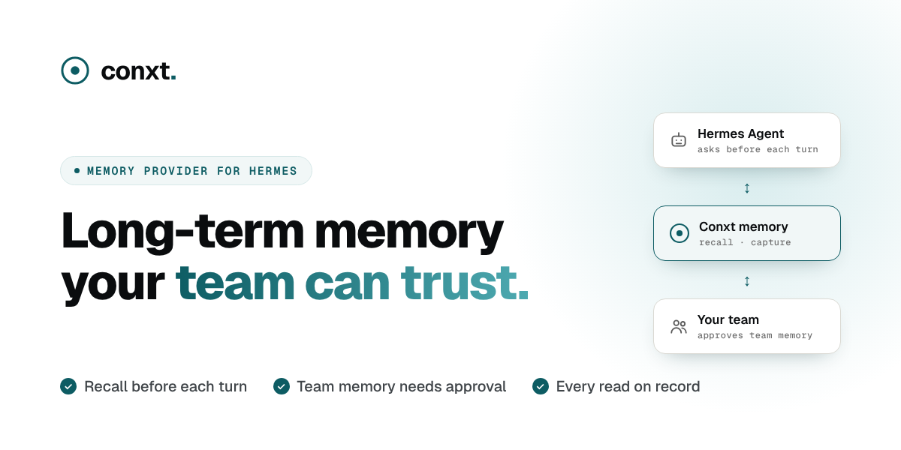

# Conxt memory for Hermes Agent



**Long-term memory for [Hermes Agent](https://github.com/NousResearch/hermes-agent) that a team can trust.**
Hermes remembers what you decided across sessions, and nothing reaches your team's memory
until a person approves it.

```bash
hermes plugins install conxt
hermes memory setup        # choose "conxt" and paste your Conxt API key
```

Get a key from the **Hermes** card at [conxt.dev/connect-ide](https://conxt.dev/connect-ide).
Any Conxt account can create one, Free included.

---

## Why Conxt

| | |
|---|---|
| 🧠 **Remembers for you** | Before each turn, Hermes gets back the decisions, preferences and project facts that match what you asked. |
| ✅ **A person approves team memory** | The agent can only *propose* a team memory. Nobody recalls it until someone on the team approves it in Conxt, and the plugin's key cannot approve its own proposals. |
| 🧾 **Every read is on record** | Each recall is logged in Conxt with what was read and who read it. |
| 🔁 **One memory across your tools** | The same memory serves Claude, ChatGPT, Cursor, Claude Code and Codex, so what Hermes learns isn't locked inside Hermes. |

## How it works

```
  your message ──► recall ──► Conxt ──► matching memories added as context
                                 ▲
  the conversation ──► batched capture ──► Conxt extracts memories from it
```

| When | What happens |
|---|---|
| **Before each turn** | Your message goes to Conxt and the matching memories come back: your own, plus your team's approved ones if a team is set. Greetings and one-word replies are skipped. |
| **After the conversation** | Turns are kept locally and sent in batches: every 5 exchanges, before Hermes compresses the context, when you switch or end a session, and at shutdown. Conxt extracts memories from each batch. |
| **When Hermes's built-in memory adds an entry** | The same text is saved to your Conxt memory. |
| **When the agent chooses** | `conxt_search` looks something up, `conxt_remember` saves a personal memory, and `conxt_propose` proposes a team memory (only when a team is set). |
| **When you run an agent folder** | `conxt_start_run` hands the agent its instructions, memory, lessons and skill level from a Conxt folder; `conxt_finish_run` saves its report, lessons and graded results. `conxt_define_agent` and `conxt_list_agents` set one up and show them all. |

## Agents that live in a Conxt folder

A Conxt project folder can be the home of an agent: its instructions (an AGENT.md), its
memory, the lessons it writes and a skill level it earns from graded results. Hermes runs it;
Conxt keeps everything between runs. Nothing else to install: the plugin's API key is enough.

1. Save the instructions once. Ask Hermes:
   *"Save this as the AGENT.md of my Conxt folder `market_watch`:"* followed by the file, or
   upload the AGENT.md into the folder from the Conxt dashboard (Import).
2. Schedule it with a Hermes cron job, with this prompt:

   ```
   Run your Conxt folder market_watch. Call conxt_start_run, follow the instructions it
   returns exactly, then call conxt_finish_run with the run id, the report, the lessons,
   graded, hits and carry.
   ```
3. Ask *"list my Conxt agents"* to see each one's runs and skill level.

Personal folders only for now; a team-scoped key is refused.

**Safe for unattended runs.** Scheduled (cron), subagent and flush runs are never written to
automatically. If Conxt is slow or unreachable, recall is skipped for that turn. Unsent turns
wait for the next attempt, up to 400 messages, after which the oldest are dropped. Nothing
ever waits for a person, so an unattended run cannot hang.

## Setup

**Requirements:** Hermes Agent 0.21.6 or later, and a Conxt API key. Team memory needs the
Conxt Team plan.

Each tool gets its own key at [conxt.dev/connect-ide](https://conxt.dev/connect-ide), so you
can see what Hermes reads and revoke its key without touching your other tools.

From the [Hermes plugin catalog](https://github.com/NousResearch/hermes-agent/tree/main/plugin-catalog):

```bash
hermes plugins install conxt
hermes memory setup        # choose "conxt", paste your API key, optionally a team id
```

Or run the latest commit instead of the catalog's pinned version:

```bash
git clone https://github.com/conxtdevelopmentteam/hermes-conxt "$HERMES_HOME/plugins/conxt"
hermes memory setup
```

You can also choose it in `config.yaml`:

```yaml
memory:
  provider: conxt
```

### Configuration

| Setting | Where | Default | Meaning |
|---|---|---|---|
| `CONXT_API_KEY` | secret (`.env`, via `hermes memory setup`) | — | **Required.** Read through Hermes's scoped secrets, per profile. |
| `CONXT_TEAM_ID` | env, or `team_id` in `$HERMES_HOME/conxt.json` | none | A Conxt team id. Adds the team's approved memories to recall and turns on `conxt_propose`. |
| `CONXT_BASE_URL` | env, or `base_url` in `$HERMES_HOME/conxt.json` | `https://mcp.conxt.dev` | The Conxt API. Must be `https`. |

Each Hermes profile has its own key, team and settings.

## What leaves your machine

Everything goes to the Conxt API at `https://mcp.conxt.dev` (or your `CONXT_BASE_URL`),
authenticated with your API key, and to nothing else.

| What | What is sent |
|---|---|
| **Recall** | The text of your message (first 500 characters), and the team id if set. |
| **Capture** | The user and assistant messages, up to 10,000 characters each. Tool calls and tool results are not sent, but anything the assistant repeats in its reply is, such as file paths, command output or code it quotes. Conxt redacts secrets it recognises before storing memories. |
| **Saves and proposals** | The memory's text, its type and a title. |
| **Mirrored memory writes** | The text of each entry Hermes's built-in memory adds. |
| **Agent folders** | Only when the agent calls one of the four agent-folder tools, including in scheduled (cron) runs: the folder name, the whole AGENT.md it saves, and each run's report, lessons, how many earlier results it graded and how many held up, and what it carries to the next run. Conxt screens these for secrets before storing them. |

No telemetry. The plugin runs no shell commands, starts no long-running processes (only
short-lived threads that send captures), and stores one file in your profile,
`conxt.json`. Conxt's [terms and privacy policy](https://conxt.dev/privacy) cover what it
stores.

## Tools only, without the plugin

Conxt also runs an MCP server at `https://mcp.conxt.dev/mcp/`. Hermes can connect to it with
an `mcp_servers` entry, which gives the agent Conxt's tools but no automatic recall or
capture: the model only uses MCP tools when it decides to. Use this plugin for memory that
works on every turn.

## Development

The tests run the provider against a stand-in Conxt server. They need Hermes on the path:

```bash
PYTHONPATH=/path/to/hermes-agent python -m pytest tests -q
hermes plugins validate . --install-deps
```

## License

MIT
